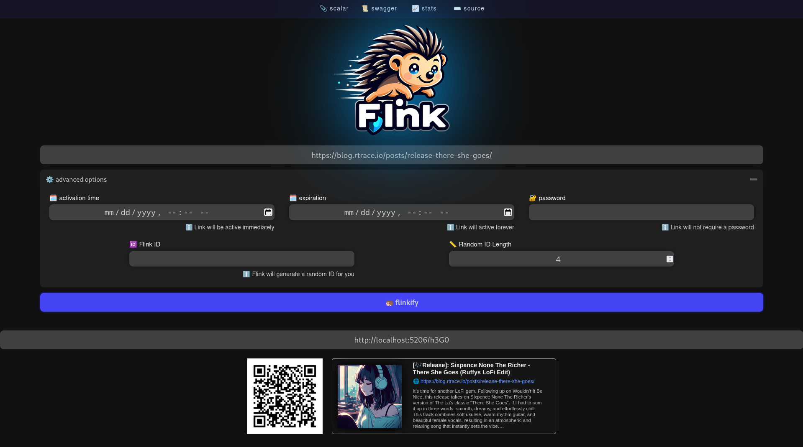

[](https://gitlab.com/rtraceio/web/flink/-/releases)
[](https://gitlab.com/rtraceio/web/flink/-/pipelines)
[](https://gitlab.com/rtraceio/web/flink/-/pipelines)
[](https://gitlab.com/rtraceio/web/flink/-/pipelines)
[](https://gitlab.com/rtraceio/web/flink/-/pipelines)

Flink is a simple, Free, Libre, and Open Source URL Shortener built with love and a ASP.NET Core 8 Web API. Why yet another URL Shortener, you might ask yourself? Well, because `flink` has a unique feature set, and demands around scalabilty, simplicity, security and traceability that no other URL shortener was able to fullfil.

## Features

- 🚀 get a production-grade `flink` instance up and running in less then 1 minute
- 📱 easy generation of QR Codes for shortened links
- 🪪 generate Link previews that are embeddable as `iframe`
- ⌨️ batch short link creation from your terminal (using `curl`, `wget` or any other board util)
- 😎 swagger (OpenAPI) and Scalar interface allowing you to build on top of `flink`
- 🖥️ runs on Linux, Windows, macOS (even Apple Silicon)
- 🐳 deployable as container (podman and docker, ARM and x86/x64), support for Kubernetes
- 📈 keep track of how often short links are visited through built-in Prometheus support
- 🌐 simple default-theme, with the possibility to create custom themes
- 🐟 spam-protection (loads ABP/AdGuard AdBlock and Phishing blocklists)
- 💾 supports Sqlite, PostgreSQL and MariaDB/MySQL
- 🗓️ shortened links accessible for given time-frames
- 🔐 password-protected/locked short links
- ☎️ triggers webhook/notification on shortened URLs and removed URLs (for [ntfy.sh](https://ntfy.sh), [Discord](https://discord.com), [Slack](https://slack.com), [Mattermost](https://mattermost.org), [Rocket.Chat](https://rocket.chat) and more)




## Flink Instances

Flink is F(L)OSS and made for the public! If you are running a Flink instance and would share it with the world, please provide a PR adding your instance details to the table below. Alternatively send an e-mail to [flink@rtrace.io](mailto:flink@rtrace.io) for the Flink team to add it to the list. Thank you ❤️

| Source                                                | Country  | Cloudflare |
|-------------------------------------------------------|:--------:|:----------:|
| [flink.is](https://flink.is)                          | 🇦🇹 AT    | ⛔ no      |
| [flink.rtrace.io](https://flink.rtrace.io)            | 🇩🇪 DE    | ⛔ no      |


## Quickstart Guide

### Start flink

```bash
# if you are using podman
podman run -p 8080:8080 quay.io/rtraceio/flink

# alternatively if you use docker
docker run -p 8080:8080 quay.io/rtraceio/flink

# yes, that's it flink is up and running 🚀
```

Flink defaults to using Sqlite unless specified. Now Flink  is up and running, visit [localhost:8080](http://localhost:8080/) to explore the Flink UI.

### Creating your first Short Link from CLI

```bash
# create a short link pointing to blog.rtrace.io with the static id "awesomeblog"
curl -X "POST" \
    -H "Content-Type: application/json" \
    -d '{ "uri": "https://blog.rtrace.io", "creator": "ruffy", "preferredId": "awesomeblog" }' \
    'http://localhost:8080/links'

# create a short link pointing to blog.rtrace.io with a random 4-character id
curl -X "POST" \
    -H "Content-Type: application/json" \
    -d '{ "uri": "https://blog.rtrace.io", "creator": "ruffy", "preferredIdLength": 4 }' \
    'http://localhost:8080/links'
```

## Flink Documentation

- **[🚀 Install Guide](/docs/install/install.md)**
    - [docker (default settings)](/docs/install/install.md#docker-default-settings)
    - [docker (default with volume for SQLite database)](/docs/install/install.md#docker-with-volume-for-database)
    - [docker-compose (with PostgreSQL)](/docs/install/install.md#docker-compose-with-postgresql)
    - [Kubernetes Deployment (with SQLite)](/docs/install/install.md#kubernetes-deployment-with-sqlite)
- **[⚙️ Configuration](/docs/config/config.md)**
    - [Proxy Configuration](/docs/config/config.md#proxy-configuration)
    - [Database Configuration](/docs/config/config.md#database-configuration)
    - [Metrics Configuration](/docs/config/config.md#metrics-configuration)
    - [WebUI Configuration](/docs/config/config.md#webui-configuration)
    - [Spam Protection Configuration](/docs/config/config.md#spam-protection-configuration)
    - [Event Notification Sinks Configuration](/docs/config/config.md#event-notification-configuration)
- **[😎 Customization](/docs/customization/custom-themes.md)**
    - [Ceate your own Flink theme](/docs/customization/custom-themes.md)
    - [Create a custom blocklist](/docs/customization/custom-blocklist.md)
- **[❤️ Community](/docs/community/install-guides.md)**
    - [Flink Setup with Docker & Nginx Proxy Manager](https://gitlab.com/rtraceio/web/flink/-/blob/main/docs/community/install-guides.md?ref_type=heads#flink-setup-with-docker--nginx-proxy-manager-2025-02-21)
    - [How To Install Flink on Your Synology NAS](https://gitlab.com/rtraceio/web/flink/-/blob/main/docs/community/install-guides.md?ref_type=heads#blogs)
    - [🇫🇷 Installer Flink avec Docker](https://gitlab.com/rtraceio/web/flink/-/blob/main/docs/community/install-guides.md?ref_type=heads#blogs)


## Roadmap

- [x] In-Memory caching to improve performance and load-reduction on the sqlite database
- [x] In-Memory caching for generated QR codes
- [x] Variable QR Code sizes (attach a URL parameter specifying height in px)
- [x] simple static UI shipped with `flink`
- [x] implement MetaData extractor (opengraph, twitter:cards, etc. ...)
- [x] implement rudimentary short link embeds
- [ ] Scalability through Federation (ActivityPub)
- [ ] Create full website snapshots (similar to the wayback machine)
- [ ] Load/Performance tests
- [ ] Optional authentication for creating short links (to prevent potential abuse)

## Contributing

Contributions to `flink` are welcome! If you have any ideas for improvements or new features, feel free to open an issue or submit a pull request.

## Support

if you have any questions, feedback or just want to stay in the loop when it comes to `Flink` make sure to stay in touch...

- [Matrix Chatroom](https://matrix.to/#/#flinkify:matrix.org)
- [E-Mail](mailto:flink@rtrace.io)

## License

Flink is licensed under the [MIT License](LICENSE), allowing you to use, modify, and distribute the software freely.
