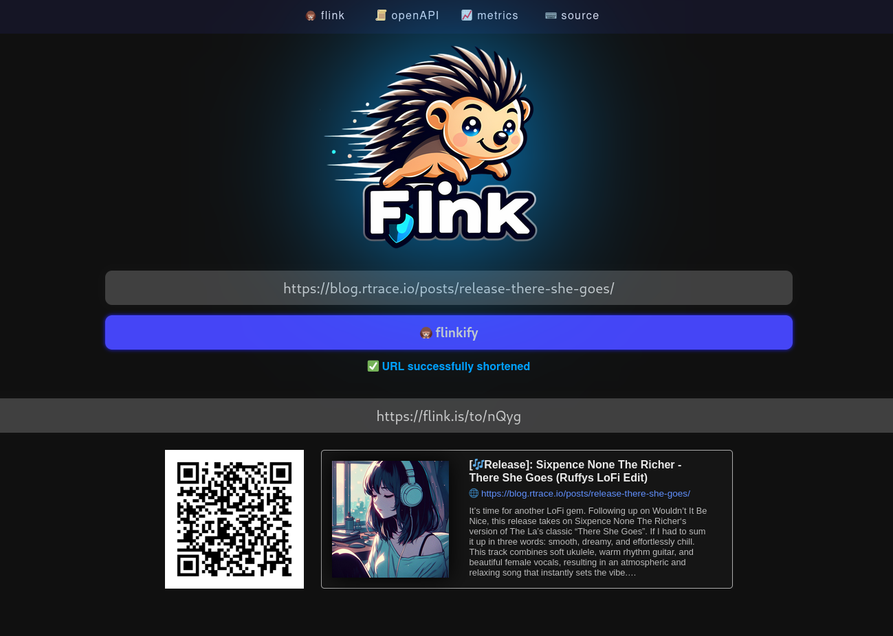

[](https://gitlab.com/rtraceio/web/flink/-/releases)
[](https://gitlab.com/rtraceio/web/flink/-/pipelines)
[](https://gitlab.com/rtraceio/web/flink/-/pipelines)
[](https://gitlab.com/rtraceio/web/flink/-/pipelines)
[](https://gitlab.com/rtraceio/web/flink/-/pipelines)

Flink is a simple, Free, Libre, and Open Source URL Shortener built with love and a ASP.NET Core 8 Web API. Why yet another URL Shortener, you might ask yourself? Well, because `flink` has a unique feature set, and demands around scalabilty, simplicity, security and traceability that no other URL shortener was able to fullfil.

## Features

- 🚀 get a production-grade `flink` instance up and running in less then 1 minute
- 📱 easy generation of QR Codes for shortened links
- 🪪 generate Link previews that are embeddable as `iframe`
- ⌨️ batch short link creation from your terminal (using `curl`, `wget` or any other board util)
- 😎 swagger (OpenAPI) interface allowing you to build on top of `flink`
- 🖥️ runs on Linux, Windows, Mac
- 🐳 deployable as container (podman and docker), support for Kubernetes
- 📈 keep track of how often short links are visited through built-in Prometheus support
- 🌐 simple default-theme, with the possibility to create custom themes
- 🐟 spam-protection
- 💾 supports Sqlite, PostgreSQL and MariaDB/MySQL




## Flink Instances

Flink is F(L)OSS and made for the public! If you are running a Flink instance and would share it with the world, please provide a PR adding your instance details to the table below. Alternatively send an e-mail to [flink@rtrace.io](mailto:flink@rtrace.io).

| Source                                                | Country  | Cloudflare |
|-------------------------------------------------------|:--------:|:----------:|
| [flink.is](https://flink.is)                          | 🇦🇹       | ⛔         |
| [flink.rtrace.io](https://flink.rtrace.io)            | 🇩🇪       | ⛔         |


## Quickstart Guide

### Start flink

```bash
# if you are using podman
podman run -p 8080:8080 quay.io/rtraceio/flink

# alternatively if you use docker
docker run -p 8080:8080 quay.io/rtraceio/flink

# yes, that's it flink is up and running 🚀
```

Flink defaults to using Sqlite unless specified.

### Creating your first Short Link from CLI

```bash
# create a short link pointing to blog.rtrace.io with the static id "awesomeblog"
curl -X "POST" \
    -H "Content-Type: application/json" \
    -d '{ "uri": "https://blog.rtrace.io", "creator": "ruffy", "preferredId": "awesomeblog" }' \
    'http://localhost:8080/links'

# create a short link pointing to blog.rtrace.io with a random 4-character id
curl -X "POST" \
    -H "Content-Type: application/json" \
    -d '{ "uri": "https://blog.rtrace.io", "creator": "ruffy", "preferredIdLength": 4 }' \
    'http://localhost:8080/links'
```

### Exploring flink with your browser

1. navigate to [/](http://localhost:8080/) and you'll see the `flink` UI
2. navigate to [/awesomeblog](http://localhost:8080/awesomeblog) and `flink` does what it does best: redirecting you
3. navigate to [/links/awesomeblog/qr](http://localhost:8080/links/awesomeblog/qr) and `flink` will give you the URL encoded as QRcode
4. navigate to [/links/awesomeblog/meta](http://localhost:8080/links/awesomeblog/meta) and `flink` will give you the Meta Data of the site it has crawled
5. navigate to [/links/awesomeblog/embed](http://localhost:8080/links/awesomeblog/embed) and `flink` will show you a nice link preview (that you can embed as iframe on your website)
6. navigate to [/metrics](http://localhost:8080/metrics) and you'll see detail metrics that can be consumed with Prometheus (and visualized with Grafana) (Username: `flink`, Password: `flink`)
7. navigate to [/swagger/index.html](http://localhost:8080/swagger/index.html) and you'll have Swagger/Swashbuckle REST Client from your browser
8. navigate to [/swagger/v1/swagger.json](http://localhost:5206/swagger/v1/swagger.json) to get the OpenAPI definition of `flink`

## Flink Documentation

- **[🚀 Install Guide](/docs/install/install.md)**
    - [docker (default settings)](/docs/install/install.md#docker-default-settings)
    - [docker (default with volume for SQLite database)](/docs/install/install.md#docker-with-volume-for-database)
    - [docker-compose (with PostgreSQL)](/docs/install/install.md#docker-compose-with-postgresql)
    - [Kubernetes Deployment (with SQLite)](/docs/install/install.md#kubernetes-deployment-with-sqlite)
- **[⚙️ Configuration](/docs/config/config.md)**
    - [Database Configuration](/docs/config/config.md#database-configuration)
    - [Metrics Configuration](/docs/config/config.md#metrics-configuration)
    - [WebUI Configuration](/docs/config/config.md#webui-configuration)
    - [Spam Protection Configuration](/docs/config/config.md#spam-protection-configuration)
- **[😎 Customization](/docs/customization/custom-themes.md)**
    - [Ceate your own Flink theme](/docs/customization/custom-themes.md)
- **[❤️ Community](/docs/community/install-guides.md)**
    - [Flink Setup with Docker & Nginx Proxy Manager](/docs/guides/install-guides.md#flink-setup-with-docker--nginx-proxy-manager-2025-02-21)
    - [How To Install Flink on Your Synology NAS](/docs/guides/install-guides.md#blogs)


## Roadmap

- [x] In-Memory caching to improve performance and load-reduction on the sqlite database
- [x] In-Memory caching for generated QR codes
- [x] Variable QR Code sizes (attach a URL parameter specifying height in px)
- [x] simple static UI shipped with `flink`
- [x] implement MetaData extractor (opengraph, twitter:cards, etc. ...)
- [x] implement rudimentary short link embeds
- [ ] Scalability through Federation (ActivityPub)
- [ ] Create full website snapshots (similar to the wayback machine)
- [ ] Load/Performance tests
- [ ] Optional authentication for creating short links (to prevent potential abuse)

## Contributing

Contributions to `flink` are welcome! If you have any ideas for improvements or new features, feel free to open an issue or submit a pull request.

## Support

if you have any questions, feedback or just want to stay in the loop when it comes to `Flink` make sure to stay in touch...

- [Matrix Chatroom](https://matrix.to/#/#flinkify:matrix.org)
- [E-Mail](mailto:flink@rtrace.io)

## License

Flink is licensed under the [MIT License](LICENSE), allowing you to use, modify, and distribute the software freely.
